# PAC: core run loop v2 (built from canon)
Carlon, for Brent Snow. Tue Oct 20 2026, ~5:45 PM ET. Design-phase paperwork only. Nothing is built and nothing here is decided.
This replaces core-loop-skeleton.md (v1, a generic PvP template). v1 stays on file unchanged.

**Sources (canon outranks everything):**
- **FS** = FULL-SCOPE.md (Drive 1eSn_y4npfoiAX1EqzO5hBx81KTxKNf1I, downloaded Oct 20 2026 ~5:25 PM ET). Cited by section, or by bullet title + line number in the long §41 tail.
- **DS** = DESIGN.md (Drive 1iG_xa5L11NhhxK-nilvLo3eNt7LyPVzE). Cited by heading.
- **IN** = INTRO.md (Drive 180kGaBBBfrNRrC6eXkdX741S2kuDthqY). It covers the intro only; nothing in it touches the run loop beyond "Pac grows with every row" (beat 7).
- **K** = Kanye's canon answers, PAC thread msg 1a15ac34325d1dfd (Oct 20, 3:21 PM ET). These are Kanye's rulings, not a canon file, so they're tagged CANON-K.
- STAT-MATH.md (Drive 1-mXxYMQuZHqbtYvLIEsdwFIgRBI5M29y) is a PROPOSAL math map, not canon. It's used only in loop-math-v1.md.

**Tags:**
- **CANON**: stated in a canon file (cited).
- **CANON-K**: stated by Kanye's 3:21 PM answer.
- **OPEN**: canon is silent.
- **CONFLICT**: two canon statements disagree. Listed at the bottom with both citations.

Where FS conflicts with DS, the later FS lines (the 2026-10-20 owner rulings, such as "THE MAP IS A MOBA ... supersedes city grids AND endless open areas", FS L1601) are read as newer. **I don't resolve conflicts here. I only list them.**

```mermaid
flowchart TD
  subgraph META["BETWEEN RUNS"]
    LOBBY["L1 Lobby: loadout + learning<br/>CANON"]
    SELECT["L2 Character select<br/>CANON"]
    TEAM["L3 Team slots, max 3<br/>CANON"]
    DIFF["L4 Difficulty = lives<br/>CANON"]
    GALAXY["L5 Galaxy map: pick level node<br/>CANON"]
  end
  LOBBY --> SELECT --> TEAM --> DIFF --> GALAXY
  GALAXY --> LTYPE{"M0 Is this level a lane map?<br/>CONFLICT C3"}
  LTYPE -- lane map --> START
  LTYPE -- "escape / other level type" --> OTHER["M0b Non-lane level types<br/>CONFLICT C3"]

  subgraph MATCH["ONE LEVEL = ONE MAP"]
    START["M1 Spawn at own base, bottom-left<br/>3/5/7 lanes, diagonal divide<br/>CANON + CANON-K"]
    CLOCK[["M2 Level time limit + time bonuses<br/>CANON / CONFLICT C1"]]
    SWARM["M3 Swarm starts few + slow, escalates<br/>CANON; curve numbers OPEN"]
    UNITS["M4 Your little units push lanes<br/>CANON; wave numbers OPEN"]
    DOTS["M5 Dot waves land on cadence, accumulate,<br/>rubber-band toward losing lanes<br/>CANON; numbers OPEN"]
    EAT["M6 Eat: pellets, fruit, coins, rings,<br/>blue orbs, stones, bad edibles<br/>CANON; values OPEN"]
    ORB["M7 Blue orb: +1 size step min, scatter,<br/>eat mode, Feast<br/>CANON; duration OPEN"]
    SIZE{"M8 Size step change<br/>CANON shape; thresholds OPEN"}
    LVL{"M9 Character level-up?<br/>XP curve OPEN"}
    OFFER["M10 Offer: ladder 1-3 skill spins, 4 Bank,<br/>5 Weapon, 6 Stone, then random mix<br/>CANON"]
    GRACE["M11 Pick grace window<br/>CANON; length OPEN"]
    DECIDE{"M12 What next? player steers<br/>CANON"}
    DEFEND["M13 Defend own lane / own towers<br/>upgrade or rebuild with resources<br/>CANON; costs OPEN"]
    PUSH["M14 Push enemy tower<br/>CANON; tower HP OPEN"]
    SIDE["M15 Side country: mini-bosses, chests,<br/>shrines, coin blocks, secret shop<br/>CANON; rates OPEN"]
    ARCH[["M16 Arch-enemy interruption,<br/>leaves at HP threshold<br/>CANON; trigger + threshold OPEN"]]
    OWNLOSS["M17 Own tower falls = pressure, not loss<br/>CANON-K; all-towers-down OPEN"]
    TDOWN{"M18 Enemy tower down?"}
    SITE["M19 Build on taken site: vision returns<br/>CANON; cost OPEN"]
    TREWARD["M20 Tower reward: more abilities + time bonus<br/>CANON; amounts OPEN"]
    THREE{"M21 3 towers down?<br/>CANON"}
    LAIR["M22 Lair: micro towers, obstacles,<br/>puzzles, mazes<br/>CANON; contents OPEN"]
    BOSSGATE{"M23 How does the boss arrive?<br/>CONFLICT C2"}
    FAIR["M24 Pre-boss fairness: offers seeded,<br/>3+ good spells vs this boss<br/>CANON"]
    BINTRO["M25 Boss intro, comic windows<br/>CANON"]
    BOSS["M26 Boss: long, multi-phase,<br/>mechanic to follow<br/>CANON; HP + length OPEN"]
    ENCORE["M27 Bomberguy encore, escapes + curse<br/>CANON"]
    DEATH["M28 Death"]
    LIVES{"M29 Lives / revives left?<br/>CANON shape; revive rules OPEN"}
    RESPAWN["M30 Come back: where, how long,<br/>what is lost - OPEN"]
  end

  START --> SWARM
  START --> UNITS
  START --> DOTS
  CLOCK -.-> DECIDE
  SWARM --> EAT
  DOTS --> EAT
  EAT --> ORB
  ORB --> SIZE
  EAT --> SIZE
  SIZE --> LVL
  LVL -- yes --> OFFER --> GRACE --> DECIDE
  LVL -- no --> DECIDE
  DECIDE -- "eat / route dots" --> EAT
  DECIDE -- defend --> DEFEND --> DECIDE
  DECIDE -- push --> PUSH
  DECIDE -- explore --> SIDE --> DECIDE
  DECIDE -- "tag in partner" --> TAGIN["M31 Tag-in swap<br/>CANON after 10 levels; rules OPEN"] --> DECIDE
  ARCH -.-> DECIDE
  UNITS -.-> OWNLOSS -.-> DEFEND
  PUSH --> TDOWN
  TDOWN -- no --> DECIDE
  TDOWN -- yes --> TREWARD --> SITE --> THREE
  THREE -- no --> DECIDE
  THREE -- yes --> LAIR --> BOSSGATE
  BOSSGATE --> FAIR --> BINTRO --> BOSS
  BOSS -- "boss dies" --> WIN
  BOSS -- "Pac dies" --> DEATH
  SWARM -. "contact / burial" .-> DEATH
  DEATH --> LIVES
  LIVES -- yes --> RESPAWN --> DECIDE
  LIVES -- no --> LOSE

  subgraph RUNEND["RUN END"]
    WIN(["E1 WIN = boss killed<br/>CANON"])
    UNLOCK["E2 Unlock roll from level roster,<br/>dupes to shards, pool grows<br/>CANON / CONFLICT C4"]
    ENDLESS{"E3 Endless option after boss<br/>CANON"}
    LOSE(["E4 LOSE = dead, no lives left<br/>Hard: character gone<br/>CANON + CANON-K"])
    CARRY["E5 What a run carries out:<br/>wallet, coins, tickets, materials<br/>CANON shape; on-loss rule OPEN"]
  end
  WIN --> ENCORE --> UNLOCK --> ENDLESS
  ENDLESS --> CARRY
  LOSE --> CARRY
  CARRY --> POST["E6 Meta: unlock levels + characters,<br/>craft + recycle gear, hidden achievements,<br/>paid respec - no account levels<br/>CANON; prices OPEN"]
  POST --> LOBBY
  OTHER --> WIN
```

## Node citations
| Node | What canon says | Tag | Source |
|---|---|---|---|
| L1 Lobby | Outside the game: equip Infinity Stones to skills, items to slots, runes and stones into items; learn new abilities (bought through achievements etc.). In-map you only upgrade what you brought. | CANON | FS L1346 "THE LOBBY"; FS L1329 "IN-MAP PROGRESSION" |
| L2 Character select | Start screen carries character select: unlocked heroes in colour, locked as silhouettes with locks. v1 = 12 blueprint heroes. | CANON / CANON-K | FS §2.2, L1299 "START SCREEN FLOW"; K #3 |
| L3 Team | Max team 3; tag-in unlocks AFTER 10 LEVELS ("level" = map, FS L1326); team grows as it scales; each member has a built-out slot and you swap. "Maybe every 25" fragment NOT ruled. | CANON | FS L1091 "TEAM UP", L1093 "TEAM SIZE", L1094, L1096, L1393 "TEAM SLOTS" |
| L4 Difficulty | Easy = 3 lives, Medium = 1, Hard = hardcore (die once, character gone). | CANON | FS L1052 "DIFFICULTY" |
| L5 Galaxy map | Universe → World → Levels, Mario 3-style nodes with chosen branches; levels clear in order; boss gates absolute; first levels start from a chosen 3-slice wedge. | CANON | FS §2.3, §3; FS L827 "FIRST LEVELS" |
| M0 / M0b | Level types: escape, unlock, capture-the-flag, area control, aggressor bonus. Stage 1 is a catered ESCAPE level whose exit opens past character level 6. MOBA ruling: "Same game modes, but structured." Canon itself flags the seam "how stage 1's catered escape opening fits the lane system". | CONFLICT C3 | FS L1305 "STAGE 1", L1334 "LEVEL TYPES", L1338, L1601 + L1615 |
| M1 Spawn / map | LoL-style maps, very large, 3/5/7 lanes, clear divide bottom-left to top; each map themed around a character; hidden criss-crosses between lanes; no home boss: "just YOU, plus your towers and your little units". Base bottom-left, boss top-right. | CANON + CANON-K | FS L1601 "THE MAP IS A MOBA", L1635 "NO HOME BOSS"; K #1 |
| M2 Clock | "Levels have TIME LIMITS. Levels have an ENDLESS OPTION once the boss is defeated"; "TIME BONUSES reward speed". Against: "Maps never end; runs escalate for hours" (FS §1, DS "Run structure", DS "Boss timing & the endless map"). | CANON / CONFLICT C1 | FS L1107 "PROGRESSION", L1608 |
| M3 Swarm | Starts with only a few, much slower ghosts; speed and numbers climb together; four AI temperaments + themed mobs + crowned elites; 13 ghost colours. Enemy troops mostly funnel down main lanes. | CANON (curve numbers OPEN) | FS §25 "SWARM CURVE"; FS §8; FS §36; FS L1670 "THE SIDE COUNTRY" |
| M4 Units | You command LITTLE UNITS that push and settle lanes; without your support they generally start LOSING, and you lose towers. Tug-of-war. | CANON (spawn/strength OPEN) | FS L1610 |
| M5 Dots | Dot waves on a numbered cadence, stacking on what's left; neglect = map fills; living dots move and replenish; dots lure you into lanes you need; rubber-band (lean where you're winning, richer where you're losing); patterns pay a completion bonus. | CANON (numbers OPEN) | FS §25 "DOT WAVES", "ACCUMULATION", "THE OVERRUN LOOP"; FS L1618 "PELLET PATTERNS", L1625 "LIVING DOTS", L1631 "DOT RUBBER-BAND" |
| M6 Eat | Eatables: pellets, fruit, blue orbs, Sonic rings, coins, Infinity Stones; each does a different job. Pellets = the eat-and-gather currency, and eating dots = XP. Fruit heals and can be stored. Coins come from struck blocks (hidden count). Bad edibles break one system each. Leveling tempo must be slower than gathering tempo. | CANON (values OPEN) | FS §21, §22, §26 (bad edibles), §27; FS L980 "CURRENCY"; DS "Core loop"; FS L1531 "COIN BLOCKS"; FS §19 |
| M7 Orb | Eating an orb grows Pac at least one size step, scatters ghosts, starts EAT MODE (chain 200/400/800/1600 score); screen inverts; The Feast vacuums every pellet; other characters get their own surge. | CANON (duration OPEN) | FS §24 "ORB LAW"; FS §7; FS L1526 "BLUE ORB EFFECT"; DS "The Feast" |
| M8 Size | Size shifting: small = fast ↔ large = huge maw. Size steps exist; the orb adds ≥1. The number of steps, the thresholds, and whether size decays: not stated. (The intro film panel reads "small → medium → huge"; that's a film frame, not a canon file.) | CANON shape; OPEN numbers | FS §5 "Forms & size"; DS "Stat upgrades"; FS §24 |
| M9 Level-up | Character levels are gained inside a map; each level-up offers X choices, VS-style. XP curve numbers not stated ("slower XP curve", "more pellets between upgrades"). | CANON shape; OPEN numbers | FS L1326, L1329; FS §7; DS "Playtest feedback v2" |
| M10 Offers | Spin offers at L1, neighbour at L2, opposite at L3; L1-3 skills only; Bank at 4 (holds 3); weapon at 5; Infinity Stone of choice at 6; then random mix (abilities, ranks, stats, buffs, currency) as a casino-style jackpot window with a speed-up button. Loadout limit ~6 things, then locked out of new ones. | CANON | FS §4; FS §25 "LEVEL 4/5/6", "THE LADDER IS UNIVERSAL"; FS §27 "BANK CAPACITY"; FS L917 "SPIN OFFERS"; FS L1044; FS L1451; FS L1540 "LOADOUT LIMIT" |
| M11 Grace | After a pick, a brief grace window (swarm held / Pac untouchable). | CANON (length OPEN) | FS §18 "THE PICK IS SACRED" |
| M12 Decide | Agency doctrine: the player steers around random draws (boss-now-or-farm, shop or save, eat vs capture…). Rushing to the end is possible, but you'd skip the pellets, "and the pellets are the power". | CANON | FS §9; FS L1670 |
| M13 Defend | Towers are UPGRADABLE (a small fraction of tower defense); a torn-down tower can be REBUILT with resources and torn down again. | CANON (costs OPEN) | FS L1650, L1654 |
| M14 Push | Fight the swarms, push the lanes, FEED THE TOWERS, get to the boss. | CANON (HP OPEN) | FS L1606 |
| M15 Side country | Hidden areas hold mini-bosses, treasure, buffs; the enemy can use them too. Chests (random items), shrines (random buffs/abilities), secret shop on every level (Kirby), small optional challenges that pay rewards. | CANON (rates OPEN) | FS L1670; FS L1535, L1537; FS §9; FS §24 "MAPS NEVER SCREW YOU" |
| M16 Arch-enemy | Darth Bomberguy and other repeatables appear sometimes to throw you off; they NEVER die; reducing their HP makes them leave; not the map boss. | CANON (trigger + HP threshold OPEN) | FS L1639 "ARCH-ENEMIES" |
| M17 Own tower falls | Towers falling is pressure, not the loss. When the push reaches your end, "it reaches YOU". | CANON-K + CANON | K #4; FS L1635 |
| M19 Site | A taken tower grants no vision until you BUILD on the site. | CANON (cost OPEN) | FS L1660 "FOG OF WAR LAW" |
| M20 Tower reward | More towers defeated = more abilities; time bonuses reward speed. | CANON (amounts OPEN) | FS L1607–1610 |
| M21 / M22 | Break THREE towers → the enemy's LAIR: micro towers, obstacles, bad guys, puzzles and mazes to reach the boss chamber. | CANON | FS L1607, L1657 "THE LAIR" |
| M23 Boss gate | Lane-map canon: the boss is unreachable until enough towers fall. Older canon: the boss spawns when the build's power rating crosses his threshold, and a refused boss becomes a spawner with an amplified escalation timer. | CONFLICT C2 | FS L1644 vs FS §8 "Boss cadence" + DS "Boss timing & the endless map" |
| M24 Fairness | Offers on the road to a boss are seeded so the player holds at least 3 good combat spells that work on him. | CANON | FS §4; DS "Pre-boss fairness" |
| M25 / M26 Boss | Comic-window character intro; long, multi-phase fights measured in minutes, each with a mechanic you must follow; raid mechanics (LOS, AOE, aggro, danger zones); bosses can be tainted versions of characters. Every level ends in a boss; every 3rd is a BIG boss; the 6th is bigger; the 7th is the Bomberman fight. | CANON (HP/length OPEN) | FS §8; FS L1084, L1086, L1253, L1564; DS "Boss fight doctrine" |
| M27 Encore | After every level boss, Bomberguy appears for an encore and always escapes (except the final level), leaving an original curse. | CANON | FS §8 |
| M28–M30 Death | Swarm burial is the fail state. Lives per difficulty. Revives live in Spirit; revives and pets are the same slot. Where you come back, how long it takes, and what you lose: not stated. | CANON shape; OPEN rules | FS §1; FS L1052; FS L870, L872 |
| M31 Tag-in | Unlocks after 10 levels; swap between three slotted members. Cooldown, shared HP/XP, whether partners act while off-field: not stated. | CANON shape; OPEN rules | FS L1091, L1393 |
| E1 Win | A WIN = killing the level boss. Lane maps: 3 towers + lair + boss. | CANON + CANON-K | FS §3; FS L1607; K #4 |
| E2 Unlock | Each boss kill grants 1 unlock drawn from that level's roster; dupes → shards; the pool is lifetime and fills only on the boss kill. Later line: access is earned by exploring the zone and beating them and the bosses, then a CHANCE TO SPIN. | CONFLICT C4 | FS §3; DS "Unlock rule", "Pool timing" vs FS L1066 "UNLOCK ACCESS", L1072 |
| E3 Endless | Endless option once the boss is defeated. | CANON | FS L1107 |
| E4 Lose | Die with no revives/lives left; Hard = character gone. | CANON-K + CANON | K #4; FS L1052 |
| E5 Carry-out | A persistent wallet carries outside the map (shop goods or respecs); coins are per character; tickets are account-wide and scarce; rings can be spent on any character; materials (metal, stone, wood, cloth) craft weapons. Whether a LOST run keeps any of it: not stated. | CANON shape; OPEN on-loss | FS §22; FS L1054, L1056, L1058, L988 |
| E6 Meta | No account levels. Unlock levels and characters, craft gear and recycle bad gear, hidden achievements (no list). Rings unlock characters, priced by rarity and distance (+5 per distance). Paid respec. Tickets buy cosmetics. Coins buy skills after X kills. | CANON (prices OPEN) | FS L1545 "THE META GAME"; FS L984, L1069, L1001, L1037, L998 |

## Which of v1's 17 OPEN nodes canon now closes
| v1 node | v1 question | v2 status | Closed by |
|---|---|---|---|
| OPEN-1 | Roster / pick rules | **CLOSED** (pick from unlocked roster, team up to 3; v1 = 12 heroes) | FS §2.2, L1093; K #3 |
| OPEN-2 | Team size, map | **CLOSED** (PvE, player + up to 2 tag-in partners; 3/5/7 lanes) | FS L1093, L1601; K #1 |
| OPEN-3 | Starting shop / items | **CLOSED** (no starting shop: loadout set in the Lobby; in-match shops are the secret shop + side country) | FS L1346; FS §9 |
| OPEN-4 | Lanes vs arena | **CLOSED** (lane maps) | FS L1601 |
| OPEN-5 | What is chompable | **CLOSED** for the list (6 eatables + edible ghosts in eat mode + bad edibles); values stay OPEN | FS §21, §26, §7 |
| OPEN-6 | Growth thresholds | **still OPEN** (numbers) | — |
| OPEN-7 | What each tier changes | **PARTLY** (small = fast ↔ large = huge maw; orb = extra chompy); per-step numbers OPEN | FS §5; FS L1526 |
| OPEN-8 | Objectives, timers, rewards | **PARTLY** (objectives = enemy towers, lair, boss, side-country mini-bosses, arch-enemies; reward = more abilities + time bonus); amounts/timers OPEN | FS L1606–1610, L1639, L1657, L1670 |
| OPEN-9 | Structure type and HP | **PARTLY** (towers, upgradable + rebuildable; lair micro towers); HP OPEN | FS L1650, L1654, L1657 |
| OPEN-10 | Kill bounty math | **PARTLY** (PvE: no hero bounties; rewards are pellets/XP, coins, drops); numbers OPEN | FS L980, L1060 |
| OPEN-11 | Tier loss on death | **still OPEN** | — |
| OPEN-12 | Win condition | **CLOSED** (3 towers + lair + boss; lose = no lives left) | FS §3, L1607; K #4 |
| OPEN-13 | Respawn formula | **PARTLY** (lives per difficulty, revives in Spirit, revive = pet slot); timer/location OPEN | FS L1052, L870, L872 |
| OPEN-14 | Buyback / early revive | **PARTLY** (no buyback in canon; revives are a stat/slot); revive rules OPEN | FS L870, L872 |
| OPEN-15 | Match length, final phase | **CONFLICT C1** (time limits + time bonuses vs runs for hours) | FS L1107, L1608 vs FS §1, DS "Run structure" |
| OPEN-16 | Catch-up rule | **CLOSED** (dot rubber-band + pre-boss fairness seeding) | FS L1631; FS §4 |
| OPEN-17 | Meta progression | **CLOSED** for the shape (no account levels; unlocks, craft/recycle, hidden achievements, wallet, respec); prices OPEN | FS L1545, §22 |

**Score:** 8 closed (1, 2, 3, 4, 5, 12, 16, 17), 6 partly closed (7, 8, 9, 10, 13, 14), 2 still open (6, 11), 1 now a CONFLICT (15). Total 17.
v1's "Fight enemy hero" branch is deleted (PvE). It's replaced by swarm/elites, arch-enemies and side-country mini-bosses.

## CONFLICT list (both sides cited; for Kanye to route, Brent rules)
- **C1 Match length.** FS L1107 "Levels have TIME LIMITS" + FS L1608 "TIME BONUSES reward speed" vs FS §1 "Maps never end; runs escalate for hours" + DS "Run structure: the long game" ("Runs are built to last HOURS, not 15 minutes"). FS L1601's MOBA ruling supersedes "endless open areas", which suggests the time-limit side is newer, but no line sets a target length. → **QUESTION FOR BRENT.**
- **C2 Boss arrival.** FS L1644 (boss unreachable until enough towers are destroyed) + L1657 (boss chamber behind the lair) vs FS §8 / DS "Boss timing" (boss spawns at a power threshold; refusing him turns him into a spawner). → **QUESTION FOR BRENT.**
- **C3 Level types vs lanes.** FS L1305 (Stage 1 = catered escape, exit after char level 6), FS L1334/L1338 (escape, unlock, CTF, area control, aggressor) vs FS L1601 ("Same game modes, but structured" on lane maps). Canon flags this seam itself (FS L1615). → **QUESTION FOR BRENT.**
- **C4 Unlock certainty.** FS §3 / DS "Unlock rule" (each boss kill grants 1 unlock) vs FS L1066/L1072 (beat them, then a CHANCE TO SPIN; "still always random"). Both may be true if "1 unlock" means one spin. → Kanye can likely settle this from the design repo; Brent only if Kanye can't.
- **C5 In-run build cap.** FS §4 "only 5 of the 13 power trees may open per run" was written on the 13-slice wheel; FS §41 moved to 7 primary stats; FS L1540 sets a ~6-item loadout limit. Which cap governs a run under the 7-stat system isn't stated. → Kanye/Claude (stat-math lane).
- **C6 New abilities in-map.** FS L1329 "New abilities ... are NOT unlocked in the map, only in the SHOPS" vs FS §4 / L917 (levels 1-3 offer SKILLS by spin). This reconciles if the spins draw from the character's own kit brought from the Lobby (FS L1346). → Kanye.

## OPEN items left in this loop (numbers or rules canon doesn't give)
1. Swarm curve numbers (M3) · 2. Unit wave interval/strength (M4) · 3. Dot wave cadence/size/rubber-band rate (M5) · 4. Pellet / coin / ring values (M6) · 5. Eat-mode and orb duration (M7) · 6. Size step count, thresholds, decay (M8) · 7. XP curve (M9) · 8. Grace window length (M11) · 9. Tower upgrade and rebuild costs (M13) · 10. Tower HP and damage (M14) · 11. Side-country rates (M15) · 12. Arch-enemy trigger and leave threshold (M16) · 13. What happens when ALL your towers fall (M17) · 14. Site build cost (M19) · 15. Tower reward size: abilities + time bonus (M20) · 16. Lair contents and length (M22) · 17. Boss HP / fight length (M26) · 18. Revive and respawn rules: where, timer, loss (M29–M30) · 19. Tag-in rules: cooldown, shared XP/HP, off-field behaviour (M31) · 20. What a LOST run keeps (E5) · 21. Meta prices: respec, crafting, recycling return (E6).

**Count: 21 OPEN + 6 CONFLICT.** Items 1–12, 14–17 and 21 are numbers; loop-math-v1.md gives OPTIONS for them. Items 13, 18, 19 and 20 are rules for Kanye/Claude to propose and Brent to rule.
